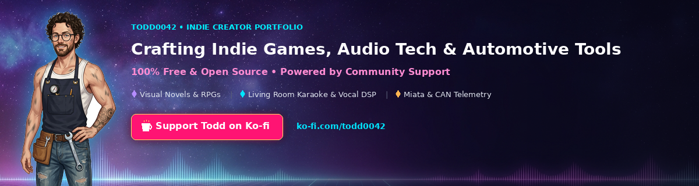
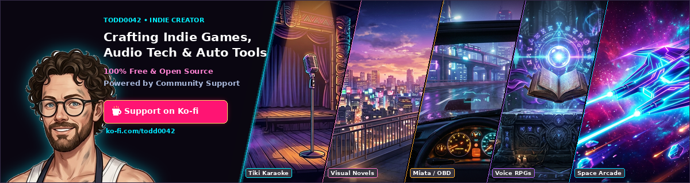

# Todd0042 • Creator Assets & Banners

Official central asset repository for Todd0042's independent software portfolio across Indie Games, Audio Tech & Automotive Tools.

---

## 🎨 Universal Banners

### 1. Horizon Panoramic Banner (`v1.0`)
A retro-futuristic synthwave horizon with Todd's mechanic sprite, cosmic nebula, and audio equalizer waveforms.

<p align="center">
  <a href="https://ko-fi.com/todd0042">
    
  </a>
</p>

```markdown
<p align="center">
  <a href="https://ko-fi.com/todd0042">
    
  </a>
</p>
```

---

### 2. Multi-Scene Slanted Montage Banner (`v2.0`)
An angled-slice cinematic montage showcasing 5 core development genres (Tiki Karaoke, Visual Novels, Miata/OBD Telemetry, Voice RPG Engines, and Retro Space Arcades) paired with Todd's bust portrait.

<p align="center">
  <a href="https://ko-fi.com/todd0042">
    
  </a>
</p>

```markdown
<p align="center">
  <a href="https://ko-fi.com/todd0042">
    
  </a>
</p>
```

---

## ☕ Support the Creator
If you enjoy any of the free, source-available tools, games, or audio software created here, consider supporting ongoing development on Ko-fi:

👉 **[ko-fi.com/todd0042](https://ko-fi.com/todd0042)**

## License

Copyright (c) 2026 [Todd0042](https://github.com/Todd0042). The art and media in this repository are licensed under **[Creative Commons Attribution-NonCommercial 4.0 International (CC BY-NC 4.0)](LICENSE)**: you may share and adapt them for non-commercial purposes with credit to Todd0042. Commercial use requires permission from [Todd0042](https://github.com/Todd0042).
